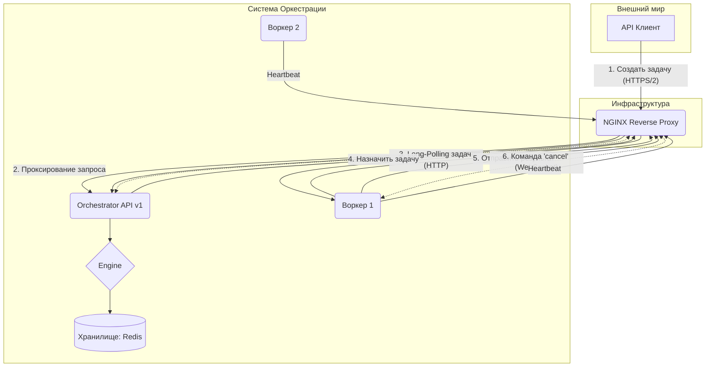

# Архитектура Оркестратора

Этот документ описывает высокоуровневую архитектуру системы оркестрации, её ключевые компоненты и их взаимодействие.

> **Примечание:** Этот документ описывает **Python-реализацию** стандарта HLN. Для ознакомления с общей архитектурной спецификацией, пожалуйста, обратитесь к пакету [`hln`](https://github.com/madgagarin/hln).

[EN](https://github.com/madgagarin/holarchy/blob/main/docs/architecture.md) | [ES](https://github.com/madgagarin/holarchy/blob/main/docs/es/architecture.md) | **RU**

## Общая схема

Система состоит из центрального **Оркестратора** и множества **Воркеров**.

### Диаграмма компонентов

## Принципы высокой производительности

Holarchy оптимизирована для максимальной пропускной способности и минимальных задержек:

1.  **Неблокирующий ввод-вывод (Non-Blocking Everything)**:
    - **Логирование**: Использование `QueueHandler` для выноса форматирования и записи логов в фоновый поток.
    - **Сериализация**: Тяжелые операции Msgpack вынесены в **Thread Pool** через `run_in_executor`.
    - **Вебхуки**: Отправляются через параллельный пул воркеров.

2.  **Стандартизированные Протоколы и Алгоритмы**:
    - **Унифицированное сопоставление (RXON)**: Использование формализованной логики протокола для подбора воркеров. Поддержка **Smart Matching (GE)** для любых числовых свойств (VRAM, RAM, CPU).
    - **Глубокая нормализация**: Слой хранения реализует рекурсивную распаковку Msgpack для устранения артефактов Redis Lua, что гарантирует 100% целостность данных.
    - **Work Stealing**: Свободные воркеры могут атомарно «красть» задачи у перегруженных коллег за время O(1).

3.  **Интеллектуальное лимитирование (Distributed Rate Limiting)**:
    - **Защита от спуфинга**: Лимиты для воркеров привязаны к криптографическому хешу их учетных данных, что делает невозможным обход ограничений через подмену идентификаторов.
    - **Атомарность**: Использование Redis для синхронизации лимитов между несколькими инстансами оркестратора.

## Безопасность (Zero Trust Architecture)

Holarchy реализует многоуровневую модель безопасности:

- **Верификация цепочки идентичности (Identity Chain)**: Каждый сигнал или событие проверяется по всему пути прохождения. Мы не просто доверяем последнему отправителю, мы проверяем источник.
- **mTLS (Mutual TLS)**: Обязательная взаимная аутентификация между Оркестратором и Воркерами с использованием сертификатов.
- **STS (Security Token Service)**: Автоматическая ротация краткосрочных токенов доступа.
- **Кэширование хэшей токенов (Token Hashing)**: Хэши проверенных токенов кэшируются в памяти (с помощью `cachebox.TTLCache`) для оптимизации нагрузки на CPU при частых Heartbeats.
- **Конфиденциальность API**: Строгий контроль детализации ответов (`DETAILED_API_RESPONSES`). Секреты и технические подробности (context snapshots) автоматически фильтруются во всех эндпоинтах и вебхуках.
- **Поддержка подписей**: Движок готов к проверке цифровых подписей в `SecurityContext` для обеспечения сквозной целостности задач.

## Контрактная безопасность (Contract Enforcement)

Важнейшим элементом защиты является строгая валидация входных и выходных данных через `output_schema`.

1.  **Двухуровневая валидация**:
    - **Worker-side**: SDK воркера проверяет результат перед отправкой, предотвращая передачу заведомо некорректных данных.
    - **Orchestrator-side**: Ядро оркестратора повторно валидирует данные перед сохранением в `state_history`. Любое отклонение переводит задачу в статус `failed` с кодом `CONTRACT_VIOLATION`.

2.  **Иерархия доверия (Schema Priority)**:
    - **Blueprint Priority**: Если схема явно задана в блюпринте (`actions.dispatch_task(..., output_schema=...)`), она имеет абсолютный приоритет. Оркестратор проигнорирует декларации воркера и применит «закон блюпринта».
    - **Worker Declaration**: Если в блюпринте схема не указана, используется схема, присланная воркером при регистрации.
    - **Safe Defaults**: По умолчанию схемы настраиваются с `additionalProperties: false`, что предотвращает «инъекцию состояния» (State Injection) — попытку воркера внедрить в память оркестратора поля, не предусмотренные логикой.

## Ключевые компоненты

### 1. `OrchestratorEngine`

Центральный координатор, управляющий жизненным циклом фоновых процессов и маршрутизацией сообщений RXON.

### 2. `Dispatcher`

Интеллектуальный роутер, сопоставляющий требования задач с ресурсами воркеров на основе стандарта протокола. Использует быстрый кэш в памяти (на базе `cachebox.TTLCache`) для снижения нагрузки на Redis.

### 3. `StorageBackend`

- **RedisStorage**: Основное высокопроизводительное хранилище для очередей задач и состояний.
- **HistoryStorage**: Слой архивации (PostgreSQL/SQLite) для аудита и истории событий.
